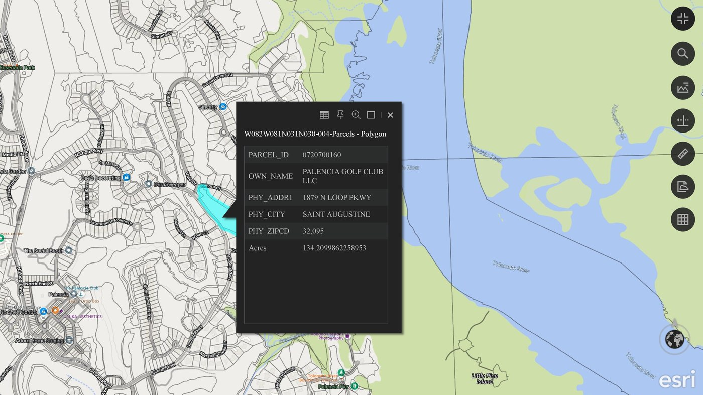

# Parcel100

> 🤖 **Using AI assistance?** Have the agent read the [CLAUDE.md](https://github.com/Jim-dc95811/ArcGIS-Earth-Unlocked/blob/main/CLAUDE.md) file first.

## Get everything you need

**1. ⬇️ [ArcGIS Earth](https://www.esri.com/en-us/arcgis/products/arcgis-earth/downloads)** - free 3D globe from Esri (Windows desktop version).

**2. ⬇️ [Python 3](https://www.python.org/downloads/windows/)** - free; install with the default options.

> **First time? Three quick tips**
> 1. **Extract the zip first:** right-click the downloaded zip > **Extract All**, then open the new folder. Double-clicking files while they are still inside the zip does not work.
> 2. **Windows security warning:** Windows may warn about any program downloaded from the internet. Click **More info > Run anyway** (blue "Windows protected your PC" screen) or **Run**. To avoid the warning, right-click the zip > **Properties** > tick **Unblock** > **OK** before extracting.
> 3. **Installing Python:** if the installer shows **"Add python.exe to PATH"**, tick it.

### **⬇️ [3. DOWNLOAD PARCEL100 v2.1](downloads/Parcel100_v2.1.zip)**
**📖 [User manual](USER_MANUAL.md)**
**🗂️ [What's in the zip - every file explained](images/parcel100_whats_in_the_zip_full.png)**
**📦 [Download the Whole ArcGIS Earth Unlocked Series of Tools - all 10 in one zip](https://github.com/Jim-dc95811/ArcGIS-Earth-Unlocked/raw/main/downloads/ArcGIS_Earth_Unlocked_All_Tools.zip)**

Turn one 1-degree Master 4 box into up to 100 small, offline, ArcGIS Earth-ready parcel GeoJSON files. **2.1 (8 Nov 2026):** asks before keeping cell files from another layer or other fields, takes links copied from the browser, gets past parcels with an empty shape, and the end message adds up to 100 cells - cells come out exactly as before ([what changed](docs/PARCEL100_V2.1_CHANGES.md)). New in 1.5.2 (Ready to Fly): the .bat installs Python for you if it is missing - answer **Y**, no admin needed.

[](https://www.youtube.com/watch?v=_hMB_TOODOQ)

*Click any parcel in ArcGIS Earth to see its owner, address and acres, offline. ▶️ [Watch the video](https://www.youtube.com/watch?v=_hMB_TOODOQ) (YouTube).*

> **ArcGIS Earth Unlocked:** Parcel100 is the parcel-intelligence component of the broader project family. See the [master system map](https://github.com/Jim-dc95811/ArcGIS-Earth-Unlocked) and the [ArcGIS Earth Object Factory](https://github.com/Jim-dc95811/ArcGIS-Earth-Object-Factory).

**Turn one 1-degree Master 4 box into up to 100 small, offline, ArcGIS Earth-ready parcel GeoJSON files.**

Parcel100 reads a public ArcGIS FeatureServer polygon layer, lets the operator choose only the fields worth carrying into the field, spatially queries the service one 0.1-degree cell at a time, skips empty cells, converts the returned parcel geometry to WGS 84 GeoJSON, and writes deterministic files that open directly in ArcGIS Earth.

The result is a lightweight offline property-intelligence layer that can ride beside TPKX imagery instead of being burned into it. The imagery answers **what does the ground look like?** Parcel100 adds **who owns this ground, what is the property address, and how many acres are involved?**

## Quick start

Windows users can unzip the package and double-click `Parcel100.bat`.

No QGIS project is required for production, and Parcel100 uses only the Python standard library.

1. Install Python 3 on Windows and confirm `py -3 --version` works.
2. Download and extract `Parcel100_v2.1.zip`.
3. Double-click `Parcel100.bat` (leave `System Files` alone - it holds the program).
4. Enter the Master 4 coordinates in **west,east,south,north** order.
5. Paste the public ArcGIS FeatureServer or MapServer URL: the service itself or its parcel layer.
6. Click **Read Service**. If the service has several polygon layers, choose the parcel layer.
7. Select the fields you want in the offline GeoJSON. For Florida, **Recommended** selects the lean field set listed under **Florida preset** below, including Acres.
8. Choose an output folder.
9. Click **BUILD 100 GEOJSON FILES**.
10. If the build is interrupted, rerun against the same Master 4 and folder; existing complete files are skipped automatically and any incomplete cell file is rebuilt.
11. Add the resulting `.geojson` files to ArcGIS Earth as local data.

See [USER_MANUAL.md](USER_MANUAL.md) for the operator guide and [TECHNICAL.md](TECHNICAL.md) for the query/geometry details.

## Video demonstration

**[Property Maps From County Property Appraiser Data](https://www.youtube.com/watch?v=_hMB_TOODOQ)**

The video shows the full problem-and-solution workflow: finding the public parcel source, working through the conventional QGIS process and reprojection steps, seeing why large-area manual production becomes cumbersome, then using Parcel100 to turn the same public parcel service into manageable offline GeoJSON cells for ArcGIS Earth.

## What Parcel100 does

1. Accepts a Master 4 box such as:

```text
82w,81w,30n,31n
```

2. Reads the metadata from a public ArcGIS FeatureServer **polygon** layer.
3. Displays the service fields and lets the operator select only the attributes to keep.
4. Splits the 1-degree Master 4 into the established **100 x 0.1-degree cells**.
5. Checks for an existing expected output filename and skips completed cells so interrupted runs can resume.
6. Sends a lightweight object-ID query for each unfinished cell.
7. Skips ocean/out-of-coverage cells that return no parcel IDs.
8. Retries transient request failures; if a full-cell ID query still fails, automatically uses four smaller internal quarter-cell ID queries and de-duplicates the returned IDs.
9. Downloads populated cells in service-sized batches.
10. Requests geometry in **EPSG:4326 / WGS 84** with Z/M values disabled.
11. Writes one local GeoJSON file per populated cell.

Example output:

```text
W082W081N031N030-004-Parcels.geojson
W082W081N031N030-005-Parcels.geojson
W082W081N031N030-006-Parcels.geojson
...
```

Each finished GeoJSON remains a real vector layer. In ArcGIS Earth the parcel polygons are clickable and the selected attributes remain available in the feature popup.

## Florida preset

Parcel100 v1.5 starts with the Florida statewide parcel FeatureServer used during development:

```text
https://services5.arcgis.com/GcvM6vDlR2gM4x31/arcgis/rest/services/FL_Parcels/FeatureServer/0
```

The **Recommended** button selects the Florida fields used in the current field workflow when they are available:

```text
OWN_NAME
PHY_ADDR1
PHY_CITY
PHY_ZIPCD
PARCEL_ID
Acres
```

The field list is not hard-coded to Florida. Click **Read Service** and Parcel100 reads the actual schema exposed by the URL you supplied.

## Other states and counties

Florida is the built-in example, not the limit of the program.

If another state or county publishes a public ArcGIS FeatureServer parcel layer, paste the URL ending in:

```text
/FeatureServer/<layer id>
```

Then click **Read Service**. Parcel100 interrogates that layer and presents its own field names. Different jurisdictions may call the same concepts `OWNER`, `APN`, `PIN`, `SITE_ADDR`, `PARCEL_ID`, `ACRES`, or something else, so the operator chooses the fields appropriate to that source.

**Need help locating the real data layer behind a public parcel map?** See [FIND_A_PARCEL_SERVICE.md](FIND_A_PARCEL_SERVICE.md).

Parcel100 does **not** bypass authentication or access controls. The source layer must be publicly accessible, or otherwise accessible to the operator outside this tool.

## Why 100 files?

A single huge GeoJSON is a poor field format for this job. Unlike an indexed tile database, a GeoJSON feature collection has to be parsed as vector features by the viewer. Large statewide or half-grid exports can become slow and memory-hungry.

Parcel100 uses the existing Master 4 10 x 10 subdivision so the operator can load only the parcel cells needed around the current area.

This also solves two server-side problems cleanly:

- each spatial query stays small;
- cells outside the source coverage are skipped automatically.

A parcel crossing a cell boundary can appear in both neighboring files. That is intentional so either cell can be used independently without chopping the parcel geometry at the cell edge.

## Field results

These are owner-reported real-world runs against the Florida statewide parcel service and ArcGIS Earth, not synthetic benchmarks.

| Master 4 run | Populated GeoJSON files | Empty cells skipped | Parcel records written | Reported folder size |
| --- | ---: | ---: | ---: | ---: |
| `82w,81w,30n,31n` | 55 | 45 | 663,277 | — |
| `82w,81w,29n,30n` | 92 | 8 | 547,183 | about 314 MB |
| `83w,82w,30n,31n` | 63 | 37 | 78,837 | — |
| `Grid 4` | 99 | 1 | 469,146 | — |

The `83w,82w,30n,31n` run completed its full 100-cell pass in about two minutes.

Individual 0.1-degree Florida test cells were observed from a few MB into the tens of MB depending on parcel density. Multiple cells were loaded together successfully in ArcGIS Earth, with parcel polygons drawing and selected owner/address/acres fields opening from the feature popup.

The v1.4 acceptance run shown above produced **55 GeoJSON files, skipped 45 empty cells, and wrote 663,277 parcel records** with the new Acres field working in ArcGIS Earth.

## Current scope

Parcel100 v1.5 is intentionally narrow:

- public ArcGIS FeatureServer **polygon** layers;
- one whole-degree Master 4 input;
- established 01-100 Master 4 cell addressing;
- selected attributes only;
- local GeoJSON output in EPSG:4326;
- empty-cell detection and skipping;
- automatic resume (complete cell files are skipped, incomplete ones rebuilt);
- every parcel ID checked, with a per-cell warning if the service leaves any out;
- visible transient-request retries;
- four-part difficult-cell ID fallback;
- timed-out download batches split and retried;
- no third-party Python packages.

It is not a parcel-data provider, national parcel database, geocoder, title search, tax system, or substitute for authoritative local records.

## Data accuracy and use

Parcel data can be stale, incomplete, generalized, misaligned, or legally different from a surveyed boundary. Owner/address/acres fields can also reflect assessment records rather than current occupancy or surveyed acreage. Treat the output as GIS/reference information and verify critical decisions with the responsible jurisdiction or property appraiser.

The user is responsible for complying with the source service's terms, public-record laws, privacy requirements, rate limits, and permitted uses.

## Relationship to Master 4 and ArcGIS Earth

Parcel100 uses the same 100-cell geography as the **Master 4 Grid Maker** from the companion offline-mapping project. That makes parcel intelligence and local map imagery addressable with the same deterministic geographic system.

A practical field pairing is:

```text
TPKX      = what the ground looks like
GeoJSON   = what the parcel database knows about the ground
```

The two remain separate layers, so parcel boundaries and attributes stay clickable instead of being flattened into imagery pixels.

## Documentation

- [USER_MANUAL.md](USER_MANUAL.md) - current 2.1 step-by-step operator manual.
- [FIND_A_PARCEL_SERVICE.md](FIND_A_PARCEL_SERVICE.md) - how to locate the real FeatureServer behind a public parcel map.
- [docs/](docs/README.md) - GeoJSON construction technical design PDF (v1.3 engineering record) and project diagrams.
- [TECHNICAL.md](TECHNICAL.md) - current v1.5 service queries, resilience, cell logic, geometry conversion and output behavior.
- [CONTINUITY.md](CONTINUITY.md) - current project handoff and proven field state.
- [RELEASE_CHECKLIST.md](RELEASE_CHECKLIST.md) - public-release/regression checklist.
- [CHANGELOG.md](CHANGELOG.md) - release history.
- [LEGAL.md](LEGAL.md) - data-source, privacy, accuracy and trademark notes.
- [CREDITS.md](CREDITS.md) - project and collaboration credits.
- [CONTRIBUTING.md](CONTRIBUTING.md) - compatibility and contribution expectations.
- [SECURITY.md](SECURITY.md) - security/privacy reporting guidance.
- [LICENSE](LICENSE) - MIT License.

## Human-AI engineering collaboration

Parcel100 was conceived, directed, tested and field-validated by **Jim Gaddy**, working with **OpenAI's ChatGPT** and **Anthropic's Claude** as AI coding and documentation partners. Jim supplied the operational problem, Master 4 architecture, real FeatureServer tests, ArcGIS Earth acceptance testing and production feedback; ChatGPT assisted with FeatureServer query design, implementation and documentation; Claude built the 1.5 release (service-root discovery and layer chooser, resume checks, completeness checks, batch splitting), its regression tests, the user manual and the page.

This acknowledgment is not a claim of OpenAI or Anthropic sponsorship or endorsement.

## Independence

Independent project; not affiliated with or endorsed by Esri, QGIS, the Florida Department of Revenue, FloridaGIO, or any state/county property appraiser.