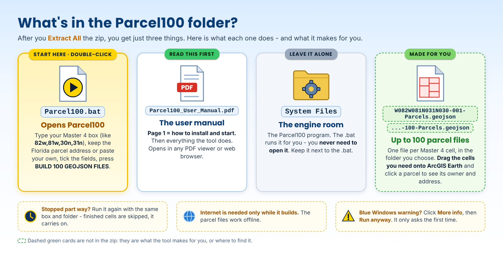

# Parcel100 2.1 User Manual

<!-- install-blurb:start -->
> ### Installing Parcel100 - read this first
>
> 1. **Open the tool's folder.** Easiest is **Google Drive** (the link at the top of the project page): the folder is already unpacked - just open it, nothing to extract. If instead you downloaded the **zip** from GitHub, right-click it > **Extract All** first, then open the new folder. (Double-clicking files while they are still inside a zip does not work.)
> 2. **Double-click `Parcel100.bat`** - the only .bat in the folder. This manual sits right next to it. The **System Files** folder holds the program - leave it alone.
> 3. **Blue "Windows protected your PC" box?** Click **More info**, then **Run anyway**. It only asks the first time. (Or, before extracting: right-click the zip > **Properties** > tick **Unblock** > **OK**.)
> 4. **Python - nothing to install by hand.** If Python is missing, the window asks **Install Python now? [Y/N]**: type **Y** and press Enter. It installs just for you (no admin needed). On an older PC this can take several minutes and Windows Defender may make the PC look frozen - **do not close the window**.
> 5. An internet connection (it downloads public parcel data) and a Master 4 box (for example `82w, 81w, 30n, 31n`).
> 6. To see the parcels you need **ArcGIS Earth** (free from Esri: https://www.esri.com/en-us/arcgis/products/arcgis-earth/downloads).
>
> Something stops it? The window says what to do in plain words, and keeps a log in `System Files\Ready_To_Fly_log.txt`. On a work computer that blocks installs, ask IT to install Python 3 from python.org.
<!-- install-blurb:end -->


A printable copy of this manual is available as [Parcel100_User_Manual.pdf](Parcel100_User_Manual.pdf).

## Purpose

Parcel100 creates up to 100 small offline parcel GeoJSON files from one Master 4 1-degree box. The files are designed for direct use in ArcGIS Earth as clickable vector layers with selected parcel attributes preserved.

The program is intended to hide the repetitive GIS/server work from the operator. You provide a geographic Master 4 box and a public ArcGIS parcel service; Parcel100 does the cell-by-cell querying and GeoJSON production.

## Requirements

- Windows 10/11
- Python 3 available through the Windows `py` launcher
- Internet access while building GeoJSON files
- A public ArcGIS FeatureServer or MapServer parcel service (the service itself or its polygon layer). [FIND_A_PARCEL_SERVICE.md](FIND_A_PARCEL_SERVICE.md) explains how to find one.
- ArcGIS Earth for the intended viewing workflow

No QGIS installation is required for production and no third-party Python packages are required.

## Start Parcel100

1. Download [`Parcel100_v2.1.zip`](downloads/Parcel100_v2.1.zip) and extract it. It contains a `Parcel100_v2.1` folder.
2. Python 3: nothing to install by hand. Since this version the .bat does it for you: if Python is missing it asks **Install Python now? [Y/N]** - answer **Y** (installs just for you, no admin; on an older PC it can take several minutes - don't close the window).

The folder holds just three things - keep them together:

```text
Parcel100.bat
Parcel100_User_Manual.pdf   (this manual)
System Files\      (the program - leave it alone)
```

Double-click:

```text
Parcel100.bat
```

The GUI opens as **Parcel100 2.1**. What changed: [docs/PARCEL100_V2.1_CHANGES.md](docs/PARCEL100_V2.1_CHANGES.md).

## What's in the zip



## 1. Enter the Master 4 box

Enter exactly four whole-degree edges in this order:

```text
west,east,south,north
```

Example:

```text
82w,81w,30n,31n
```

The box must be exactly 1 degree wide and 1 degree tall.

Parcel100 subdivides the box into the established 100 Master 4 cells, each approximately 0.1 degree by 0.1 degree in geographic coordinates.

## 2. Enter the parcel service URL

You can paste the service itself, ending in `/FeatureServer` or `/MapServer`; Parcel100 1.5 finds its polygon layers when you click Read Service. A link copied from the browser with `?f=pjson` or `/query` on the end works too. Or point directly to a polygon layer, normally ending in:

```text
/FeatureServer/0
```

or another numeric layer ID.

Florida preset:

```text
https://services5.arcgis.com/GcvM6vDlR2gM4x31/arcgis/rest/services/FL_Parcels/FeatureServer/0
```

For another state or county, paste that jurisdiction's public parcel service or layer URL instead. See [FIND_A_PARCEL_SERVICE.md](FIND_A_PARCEL_SERVICE.md).

A web-map or web-app URL is not the same thing as the service URL. Parcel100 needs the ArcGIS REST service (`.../rest/services/.../FeatureServer` or `.../MapServer`).

## 3. Click Read Service

Click:

```text
Read Service
```

Parcel100 reads the layer metadata and populates the field list. If the service has only one polygon layer, it is used automatically.

If you pasted a service root, Parcel100 checks each layer (the status line shows `Checking layer N of M`). When there is more than one polygon layer, choose the parcel layer from the list and click **Use Selected Layer**. Layers that did not respond are listed in orange; if the parcel layer might be one of them, click Cancel and try again later, or paste that layer's own URL.

If you change the URL after Read Service, click Read Service again before building. Parcel100 will remind you.

The status line reports the number of fields and the service's reported maximum record count.

If the field list remains empty, verify that:

- the URL points to a FeatureServer/MapServer service or one of its layers;
- the service is public/reachable;
- the layer is a polygon layer.

## 4. Select fields to keep

The field list controls what parcel attributes are written into every GeoJSON feature.

For the Florida statewide layer, the current lean field set is:

```text
OWN_NAME
PHY_ADDR1
PHY_CITY
PHY_ZIPCD
PARCEL_ID
Acres
```

Click **Recommended** to select those fields when they exist. **Select All** and **Clear** select or clear the whole list. Hold Ctrl and click to add or remove single fields.

Other jurisdictions use different names, so inspect the aliases shown beside each field and select what is useful for your purpose.

Useful categories commonly include:

```text
Owner name
Physical/site address
City
ZIP/postal code
Parcel/APN/PIN identifier
Acres / area field
Public-land flag
```

Avoid selecting everything unless you truly need it. Fewer attributes produce smaller, cleaner field files and simpler ArcGIS Earth popups.

## 5. Choose the output folder

Use **Browse** or type a folder path.

Parcel100 creates the folder if necessary.

## 6. Coordinate precision

Default:

```text
7
```

This controls the coordinate precision requested from the FeatureServer for the returned WGS 84 geometry.

The supported GUI range is 5 through 12.

For ordinary parcel display, the default is a good balance between geometry detail and file size.

## 7. Build the files

Click:

```text
BUILD 100 GEOJSON FILES
```

Parcel100 processes the Master 4 cells in order.

Before making any server request for a cell, Parcel100 computes the exact expected output filename. If a complete file with that name already exists in the output folder, the cell is skipped (see **Resume an interrupted build** below).

For each unfinished cell it first asks the service only for matching object IDs. If there are no matching parcel IDs, the cell is marked empty and skipped.

A successful empty-cell result is different from a server failure. A network/service error is retried and is never silently treated as an empty cell.

If a normal 0.1-degree object-ID query repeatedly fails with a transient error such as a timeout, 502/503/504, remote-end-close, or connection reset, Parcel100 automatically divides that cell into four smaller internal query envelopes. It queries each quarter, de-duplicates the IDs, and then continues the normal feature download for the original cell.

For populated cells, Parcel100 downloads the parcel features in service-sized batches and writes one GeoJSON file. It checks every parcel ID off as the features arrive and asks the service once more for any that are missing.

The status line shows which cell is being worked on, and the progress bar fills as cells finish.

## Output naming

Example Master 4:

```text
82w,81w,30n,31n
```

Example files:

```text
W082W081N031N030-004-Parcels.geojson
W082W081N031N030-005-Parcels.geojson
W082W081N031N030-006-Parcels.geojson
```

The three-digit cell number matches the established Master 4 cell addressing.

Only populated unfinished cells are written.

## Completion message

At the end Parcel100 reports the **100 cells** as three numbers that always add up to 100, then the parcels:

```text
100 cells:
   64 written
   36 already there (skipped)
   0 empty - no parcels (skipped)

48,212 parcels written into the 64 new files.
```

It also lists:

- parcels the service sent with **no shape** (they are in the files with their fields but draw nothing);
- cells **replaced** because their old files came from another layer or field list (see Resume);
- any incomplete cell files that were rebuilt;
- a **warning** listing cells where the service did not return every parcel, even after asking again. Those cells are still written; to try them again later, delete their files and build again.

A field-tested Florida run produced:

```text
55 GeoJSON files
45 empty cells skipped
663,277 parcel records written
```

Parcel100 1.4 reproduced this result in its acceptance run, with the new `Acres` field visible and working in ArcGIS Earth.

A second Master 4 produced:

```text
92 GeoJSON files
8 empty cells skipped
547,183 parcel records written
about 314 MB total
```

These are real-world examples, not guaranteed sizes or speeds.

## Resume an interrupted build

Rerun Parcel100 with the same Master 4 and the same output folder.

Any complete GeoJSON cell file already present is skipped before a server query is made. Missing cells continue normally.

Each cell is written as a `.partial` file and renamed only when complete, so an interruption cannot leave a half-written cell. An existing cell file that is not complete GeoJSON (for example, one left by an interrupted older version) is rebuilt and listed in the completion message. If you intentionally want to rebuild a complete cell, delete that cell's GeoJSON first.

**Another layer or other fields into the same folder (2.1):** when you click BUILD, Parcel100 checks the cell files already in the folder. If any came from a different layer, or hold a different set of fields, it asks:

- **Yes** - replace them with this layer and these fields (an old cell the new layer has no parcels in is removed);
- **No** - keep the old files (they are skipped, as before);
- **Cancel** - build nothing.

A true resume - same layer, same fields - is not asked about; it just continues.

## Open the results in ArcGIS Earth

In ArcGIS Earth, add one or more `.geojson` files as local data.

The parcel polygons remain vector features. Click a parcel to open the feature popup and inspect the selected fields.

A practical offline stack is:

```text
TPKX imagery
+ local Parcel100 GeoJSON
+ other operational vector layers/pins
```

Do not flatten the parcel layer into raster MBTiles/TPKX if you want the parcel attributes to remain clickable.

## Why the files are split

GeoJSON is not a tiled database like MBTiles/TPKX. Very large GeoJSON files can take substantial time and memory to parse in a viewer.

The 100-cell design keeps each feature collection geographically small and lets the operator load only the area needed.

It also keeps FeatureServer queries manageable and naturally skips ocean/out-of-state/out-of-coverage cells.

## Boundary behavior

Parcel100 queries each cell using an `intersects` spatial relationship.

A parcel crossing a cell edge can therefore appear in both neighboring GeoJSON files. This is intentional. Each cell remains independently useful and retains the full parcel geometry.

## Other states

Parcel100 is not limited to Florida.

To try another jurisdiction:

1. Find a public ArcGIS parcel service ([FIND_A_PARCEL_SERVICE.md](FIND_A_PARCEL_SERVICE.md)).
2. Paste the service or layer URL into Parcel100.
3. Click **Read Service**.
4. Select that jurisdiction's owner/address/parcel/acres fields.
5. Enter a Master 4 covering the desired area.
6. Build.

Coverage and schema vary widely. Some states publish statewide parcel layers; others publish county-by-county layers.

## Troubleshooting

### Read Service fails

"The server did not send map data" means the link led to a login page or something that is not an ArcGIS REST service; use the public `/FeatureServer` or `/MapServer` link.

Check the URL in a browser. It should open an ArcGIS REST page for the service or layer; a parcel layer reports `Geometry Type: esriGeometryPolygon`. If Parcel100 says it requires a polygon layer, the URL points to a point or line layer; use the parcel layer instead. If it lists layers that did not respond, try again later or paste the parcel layer's own URL.

### Build pauses and shows retry text

That is expected resilience behavior. Parcel100 retries transient request failures up to three times. A repeatedly failing full-cell ID query may then switch automatically to the four-part fallback. A download batch that keeps timing out is split in half and retried, which shows as `batch of N parcels timed out - splitting`.

### Build stops on one cell

A persistent service or connectivity problem is treated as an error. Re-run after confirming the source service is available. Completed files already in the output folder will be skipped.

### ArcGIS Earth shows nothing

Confirm the GeoJSON was produced by Parcel100 and that the view is near the Master 4 area. Parcel100 requests output geometry in EPSG:4326 / WGS 84.

### Warning that some parcels were not returned

The service skipped some parcels even after Parcel100 asked a second time. The listed cells were written without them. Delete those cell files and build again later to retry them.

### Popup has too much information

Rebuild with fewer selected fields.

### Acres is missing

The source service must actually expose an acreage/area field. For the current Florida preset, `Acres` is included in the Recommended selection. Other jurisdictions may use a different field name or provide no acreage attribute.

### Some parcels appear in two files

Expected at cell boundaries. Parcel100 preserves complete parcel geometry instead of clipping parcels to the cell edge.

## Data caution

Parcel GIS is reference data. It can be stale, generalized, misaligned, or different from a surveyed/legal boundary. Owner/address/acres data may represent assessment records rather than current occupancy or surveyed acreage.

For critical property decisions, verify against the responsible property appraiser, recorder, survey, deed, or other authoritative source.
